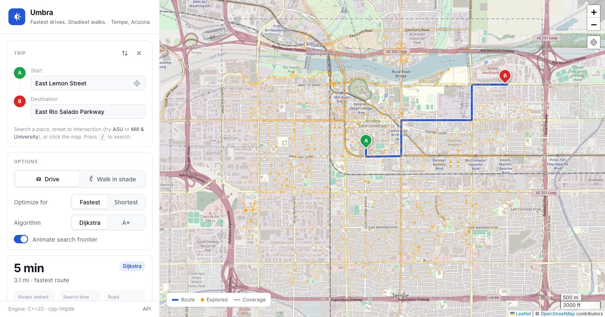
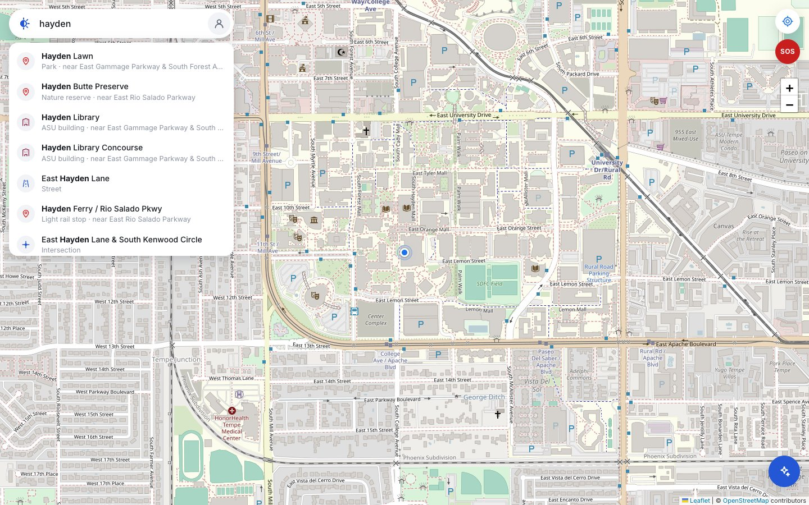
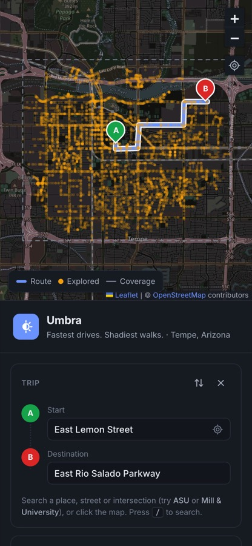
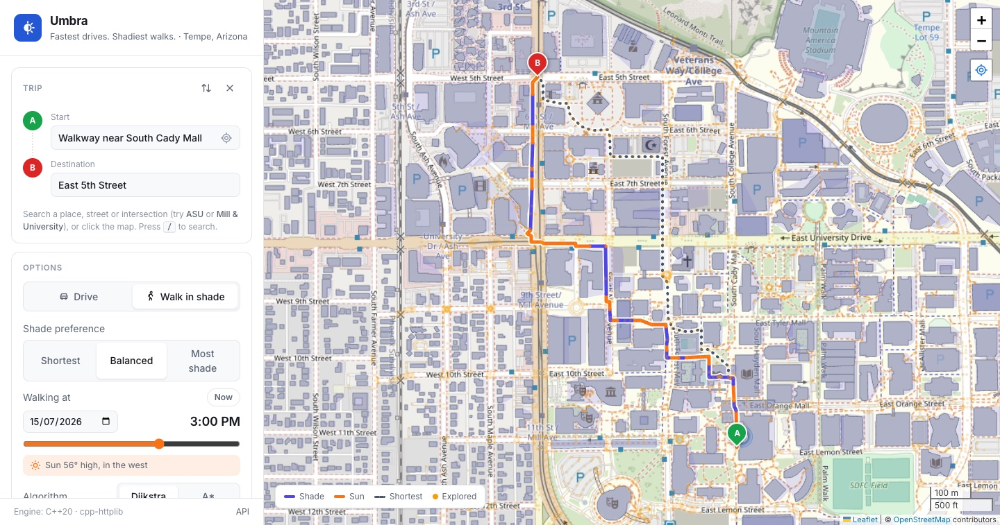
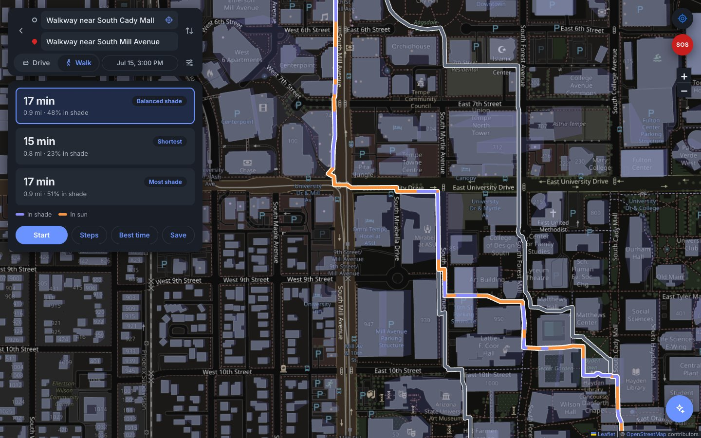
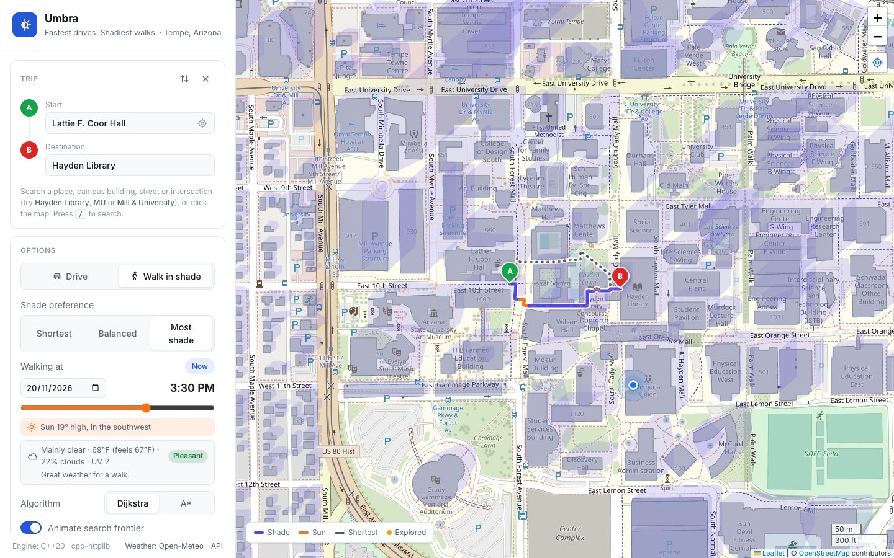
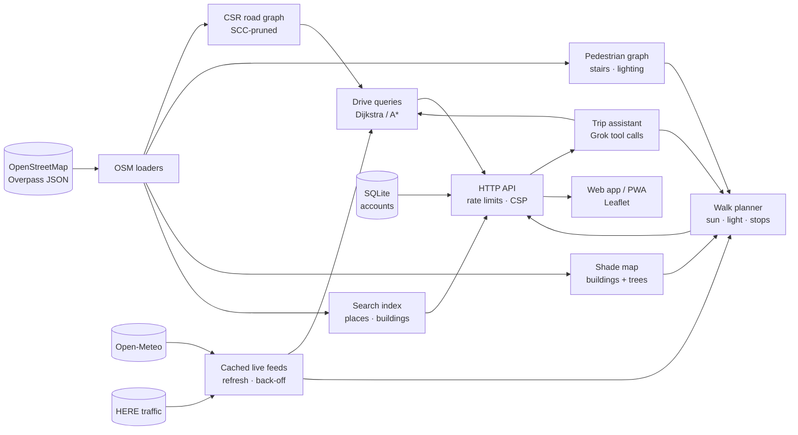

# Umbra: Fastest drives. Shadiest walks.

### Fastest drives. Shadiest walks.

*Umbra* (Latin for "shadow") is a C++20 routing engine and web app for Tempe, Arizona, built on real
OpenStreetMap data: drives that account for live traffic, rain and sun glare, and walks that keep you
out of the desert sun, using live weather, 15,000+ building shadows and directions to the entrances of
ASU's buildings. It installs on a phone, speaks turn-by-turn directions, and can plan a trip from a
question in plain English.

[](../../actions/workflows/ci.yml)
[](../../actions/workflows/codeql.yml)




## Features

| | |
|---|---|
| **A real maps app** | Full-screen map with a floating search bar (Google / Apple Maps style); every screen has its own URL, so Back works; a bottom sheet on phones and a side panel on desktop; **2-3 route choices** to pick from; Profile & settings; light, dark or system theme. |
| **Drive** | Fastest or shortest route with Dijkstra / A\*, one-way streets and speed limits; **live traffic** (HERE, optional key); **rain, fog and snow slowdowns** from FHWA road-weather research; **sun-glare avoidance**: steer away from roads heading into a low sun, with a setting for drivers whose visor doesn't shade their eyes. |
| **Walk in shade** | Shadows from real buildings and trees for any date and time, traded off against distance (*"Adds 340 ft (+8%) to walk 25 more percentage points in the shade"*); **live weather** sets how much shade is worth and rates how pleasant the walk is. |
| **Plan around the heat** | **Best time to leave** compares up to 16 departure times; **stop for water** routes via the drinking fountain that adds the least; **step-free** routes avoid stairs; after dark, routes prefer **lit streets**. |
| **ASU buildings** | Search 194 buildings by name or code (*Hayden Library*, *COOR*, *MU*); routes end at the entrance that is quickest to reach. |
| **Navigation** | Location shown as soon as the app opens; follow-me navigation with **spoken turns** and automatic re-routing. |
| **Safety** | Opt-in **danger phrase** (speech recognition) or an **SOS** button starts a 10-second cancellable countdown, then texts your emergency contact your **current** location (a fresh GPS fix taken during the countdown) and offers a one-tap call to them or 911. |
| **Ask Umbra** | The button at the bottom right. A Grok-powered assistant (optional key) that answers *"When is it coolest to walk to the MU today?"* by calling Umbra's own engine as tools (it never makes up a route), and *"Where do I set my emergency contact?"*. Quick links work without a key. |
| **Accounts** | Saved places and recent trips; export or delete everything at any time. |
| **Anywhere** | Installable on iPhone and Android (web-app manifest, offline shell), dark mode, shareable links, accessible search. |

## Under the hood

| | |
|---|---|
| **Algorithms from scratch** | Dijkstra and A\* on a hand-written **indexed binary min-heap with decrease-key**, generalised to **multi-source / multi-target** search; **alternative routes** by the penalty method; **Kosaraju's SCC**; a **CSR graph**; **uniform-grid spatial indexes**; an **inverted-index** search engine with typo tolerance; **convex hulls**; a **2-D DDA** grid traversal: no graph or geometry libraries. |
| **Physics** | NOAA solar position; exact prism shadow tests; a Meinel clear-sky model that turns forecast irradiance into *sun strength*; NWS heat-index comfort bands; FHWA weather speed factors. |
| **Real data** | 13,025 intersections and 23,627 road segments, a 63k-node pedestrian network, 15,685 buildings, 1,822 trees, 194 ASU buildings and 15 water fountains from OpenStreetMap; live Open-Meteo weather and HERE traffic. |
| **Backend** | C++20 HTTP server (cpp-httplib) with SQLite + libsodium accounts, live data refreshed on background threads (a slow provider never delays a request), an LLM tool-calling loop, rate limiting and a strict Content-Security-Policy. |
| **Fast** | A drive search takes **≈ 0.6 ms** and a shade-aware walk ≈ 15–20 ms; one process serves ~2,150 routes/s (see [Capacity](docs/DEPLOYMENT.md#5-capacity)). |
| **Verified** | 162 GoogleTest cases (property tests against Bellman-Ford, brute force and all-pairs search; alternative-route limits; traffic / rain / snow / fog / night / glare scenarios; account security; the assistant against a fake model) and 14 JavaScript tests (navigation, emergency location, safety, departures). CI runs Release and **ASan + UBSan** builds on Linux and macOS, a Docker smoke test and CodeQL. |

<p align="center"></p>

## The app

<p align="center">
  
  &nbsp;&nbsp;
  
</p>

| Screen | What it does |
|---|---|
| Map | Search bar with the logo and your profile; locate, SOS and Ask Umbra buttons; nothing else |
| Place | Name and details of a search result or dropped pin: **Directions**, Start here, Save |
| Directions | From / To, Drive / Walk, departure time, route options; 2-3 route cards (tap one, or tap a grey line on the map) |
| Steps, Best time, Navigation | Turn-by-turn list; departure-time comparison; follow-me navigation with voice and a Stop button |
| Profile & settings | Account and saved places, Emergency, theme (System / Light / Dark), Help, Developer mode, About, Download my data, Sign out, Delete account |

The algorithm details (Dijkstra vs A\*, nodes explored, the search animation) are behind **Developer
mode** in Settings, so the app stays clean while the engine stays easy to inspect.

## Walk in shade



At 3:00 PM on July 15 the sun is 56° up in the west, so buildings cast shadows to the east. Walking from
the Memorial Union area to Mill Ave & 5th St, the shortest route (grey) is **23 %** shaded; the balanced
shade-aware route uses the east sides of north–south streets and is **48 %** shaded for **+9 %**
distance, and *Most shade* reaches 51 %.

| Preference | Cost of a metre in direct sun (clear sky) |
|---|---|
| Shortest | 1 m (sun ignored) |
| Balanced | 2.5 m |
| Most shade | 6 m |

**Live weather.** The server fetches a 7-day hourly forecast for the map's centre from Open-Meteo (no
key) every 10 minutes. *Sun strength* = forecast direct normal irradiance ÷ clear-sky irradiance
(Meinel model), from 0 to 1, multiplies the sun penalty: under thin cloud the route accepts less detour
for shade, and under overcast skies (no shadows) it takes the shortest walk. The "feels like"
temperature, rain, wind and UV give a rating: **pleasant**, **fair** (from 80 °F), **caution** (from
90 °F, rain, cold, wind) or **dangerous** (from 103 °F, thunderstorms), following the National Weather
Service heat-index bands.

**After dark** shade no longer matters, so a metre on an unlit way costs 3 m and on a way with unknown
lighting 1.25 m. **Step-free** walks treat stairs (and `wheelchair=no` ways) as impassable. **Stop for
water** picks the fountain *s* minimising cost(start, *s*) + cost(*s*, end) with two multi-source
Dijkstra runs, instead of one route per fountain.

<p align="center"></p>

## Directions to ASU buildings



Each building knows its mapped entrances or, where none are mapped, 12 points around its footprint.
All of them become targets of **one** multi-target search, so the route ends at the door that is
quickest to reach (and leaves by the best exit when a building is the start). The A\* heuristic becomes
the distance to the *nearest* target, which keeps it admissible and consistent. The data comes from
OpenStreetMap; ASU's own campus map has no open data license, so it is not copied here.

## Route choices

Like Google Maps, Umbra offers 2-3 routes. **Drives** use the *penalty method*: after each search the
roads of the route found cost 1.4× more, so the next search prefers other roads; a candidate is kept
if it costs at most 35 % more than the best and shares at most 75 % of its length with the routes
already kept. Each is labelled by what makes it different (*Shorter*, *Fewer turns*, *Less sun glare*)
or by its main road (*via South Smith Road*). **Walks** offer one route per shade preference
(*Shortest*, *Balanced shade*, *Most shade*) when they take different paths.

## Driving conditions

Drive times combine three inputs for the chosen departure time (live traffic only applies within 15
minutes of now). Each can only make an edge more expensive, so the free-flow A\* heuristic stays
admissible:

| Input | Source | Effect |
|---|---|---|
| Traffic | HERE Traffic v7 flow for the whole map, every 15 min | Each road edge takes the current/free-flow speed ratio of the nearest reported stretch running the same way (within 15 m and 30°) |
| Weather | Open-Meteo | Freeways −7.5 % in rain, −11.5 % in heavy rain, −34.5 % in snow; streets −17.5 % when wet, −35 % in snow; −11 % in fog (midpoints of the FHWA ranges) |
| Sun glare | NOAA sun position at the departure time | An edge is "into the sun" when the sun is up, below 20° (35° with *My sun visor doesn't shade my eyes*) and within 25° of the driving direction. With **Avoid driving into the sun**, such minutes cost 3× in the search, and the result says how much glare was avoided and at what cost. |

Glare is about geometry: on Tempe's east–west grid the setting sun is within 25° of westbound roads
around the equinoxes (in late March a westbound evening drive across Tempe faces it for over 3
minutes), while in November it sets in the south-west, off-axis. When the destination itself lies
toward the sun, some glare cannot be avoided, and the app says so.

## Safety

Turn on **Listen for my danger phrase**, choose a phrase of two or more words, and add an emergency
contact (or tick *Call 911*). While Umbra is open, it listens with the browser's speech recognition.
Saying the phrase, or pressing **SOS** on the map, starts a full-screen 10-second countdown with a large
**Cancel**. When it ends, Umbra opens your Messages app with a text to your contact containing your
location and a map link, so your location goes out whether or not anyone answers, and shows a
one-tap **Call** button for your contact or 911.

Limits set by iOS and Android: a web page cannot send a text or start a call without your tap, and it
can only listen while it is open on screen. Settings stay on your device. Chrome sends audio to
Google's speech service and Safari to Apple's (or recognises it on the device). No service may call
or text 911 automatically. **This is a convenience, not a replacement for calling 911 yourself.**

## Ask Umbra

The assistant sends the question to xAI's Grok with five tools: `search_places`, `plan_walk`,
`plan_drive`, `get_weather` and `best_departure`. Grok decides which to call; the C++ server runs them
on its own engine and returns the results; Grok writes the answer, and the route appears on the map.
At most 6 model calls per question, 20 questions per hour per account, and the API key never leaves
the server.

## Benchmark

500 random origin/destination pairs on the Tempe network (Apple clang 21, `-O3`, single thread):

| Metric | Algorithm | Avg nodes settled | Avg time | p50 | p95 |
|---|---|---:|---:|---:|---:|
| Fastest (time) | Dijkstra | 6,592 | 0.60 ms | 0.58 ms | 1.20 ms |
| Fastest (time) | **A\*** | **3,865** (−41%) | 0.57 ms | 0.45 ms | 1.50 ms |
| Shortest (distance) | Dijkstra | 6,665 | 0.62 ms | 0.54 ms | 1.08 ms |
| Shortest (distance) | **A\*** | **1,922** (−71%) | 0.30 ms | 0.19 ms | 0.88 ms |

Both algorithms returned identical optimal costs on every query. A\* helps less for *time* because its
heuristic divides straight-line distance by the network's top speed (~105 km/h) to stay admissible.
Reproduce with `./build/release/umbra_bench data/tempe.osm.json 500`.

## Quick start

**Prerequisites:** macOS or Linux, a C++20 compiler (Clang ≥ 14 or GCC ≥ 11), CMake ≥ 3.25, Ninja,
libsodium, SQLite and libcurl.

```bash
brew install cmake ninja libsodium                       # macOS (SQLite and libcurl ship with it)
sudo apt install g++ cmake ninja-build pkg-config \
  libcurl4-openssl-dev libsqlite3-dev libsodium-dev       # Debian / Ubuntu

cmake --preset release && cmake --build --preset release && ctest --preset release
./build/release/umbra_server                             # open http://127.0.0.1:8080
```

Other dependencies (nlohmann/json, cpp-httplib, GoogleTest) are fetched at pinned versions.
`--preset debug` builds with AddressSanitizer + UBSan. With Node ≥ 20 installed, `ctest` also runs
the web unit tests (or run `npm test`). Windows is not supported yet.

### API keys

**None are required.** Map data is bundled, map tiles and weather need no key, and accounts use a
local SQLite file. Two optional features need your own key in `.env` (git-ignored; see
[.env.example](.env.example)):

| Variable | Enables | Where to get it |
|---|---|---|
| `HERE_API_KEY` | Live traffic | [HERE platform](https://platform.here.com) → REST API key (check the free allowance on your plan) |
| `XAI_API_KEY` | Ask Umbra assistant | [xAI console](https://console.x.ai) (billed per token; `grok-4.7` is $2 / $6 per million input / output tokens) |

Without them the server simply hides those features. Google Maps is not needed: its terms restrict
using its data with non-Google maps, and OpenStreetMap already provides everything Umbra routes on.

### Phone and hosting

Run it on a phone through an HTTPS tunnel and **Add to Home Screen** (iPhone) or **Install app**
(Android): no Xcode or Android Studio needed. To host it, the `Dockerfile` runs on any HTTPS container
platform. Step by step: [docs/DEPLOYMENT.md](docs/DEPLOYMENT.md).

### Use another city

```bash
scripts/fetch_all.sh "37.765,-122.430,37.800,-122.385" sf   # bbox ≈ 5 km × 5 km; writes data/sf.*.json
./build/release/umbra_server --data data/sf.osm.json --places data/sf.places.json \
    --campus data/sf.campus.json --water data/sf.water.json \
    --walk data/sf.walk.osm.json --shade data/sf.shade.json \
    --region "San Francisco, CA" --timezone America/Los_Angeles
```

## Data

Everything is real, public data; nothing is synthetic. Test fixtures in `tests/data` are small
hand-written inputs, never shown to users.

| Data | Source | License | Refresh |
|---|---|---|---|
| Roads, footways, buildings, trees, places, ASU buildings, fountains | OpenStreetMap via the Overpass API | ODbL | `scripts/fetch_all.sh`, committed in `data/` |
| Weather forecast | [Open-Meteo](https://open-meteo.com/) | CC BY 4.0 | live, every 10 min |
| Traffic flow | [HERE Traffic API v7](https://docs.here.com/traffic-api/docs/send-request-readme) | HERE terms | live, every 15 min (with a key) |
| Map tiles | OpenStreetMap | ODbL | live |

**ETL.** *Extract:* the `scripts/fetch_*.sh` Overpass queries (retried across mirrors). *Transform
and load:* at start-up the C++ loaders validate the JSON, filter tags, compute lengths and speeds,
prune to the largest strongly connected component, estimate building heights, match buildings to
campuses and entrances, and build the CSR graph and indexes (about 1 s). Live feeds are parsed,
validated and, for traffic, map-matched onto the graph on each refresh.

**User data.** Only for people who create an account: email, an Argon2id password hash, saved places
and the last 50 trips, in SQLite. Nothing about anonymous users is stored; logs omit query strings.

## How it works



| Component | Technique | Complexity |
|---|---|---|
| Road graph | Compressed Sparse Row (built with counting sort) | build O(V + E), memory O(V + E) |
| Priority queue | Indexed binary min-heap with **decrease-key** (position table) | push / pop / decrease-key O(log V) |
| Shortest path | Dijkstra; A\* with admissible, consistent great-circle heuristic | O((V + E) log V) |
| Building entrances | Multi-source / multi-target search (virtual super-source; heuristic = distance to nearest target) | one search instead of \|S\| × \|T\| |
| Route choices | Penalty method with a stretch limit and an overlap limit | up to 7 searches |
| Water stop | Two multi-source Dijkstra runs, then argmin over stops of d(start, s) + d(s, end) | 2 searches instead of one per stop |
| Connectivity | Kosaraju's SCC, iterative DFS | O(V + E) |
| Nearest node | Uniform grid with ring search | O(k) for k nodes in visited cells |
| Text search | Inverted index over a sorted vocabulary; prefix via binary search; Levenshtein ≤ 1 fallback | O(q log W + matches) |
| Shadows | Prism shadow test, uniform grid + Amanatides–Woo DDA traversal | O(cells on ray + candidates) per point |
| Traffic matching | Provider segments bucketed in a uniform grid; nearest same-direction segment per edge | O(E · segments per cell) per refresh |
| Live feeds | `CachedResource<T>`: background refresh thread, failure back-off, max age, shared immutable snapshots | O(1) per request, never waits for the provider |
| Rate limiting | Token bucket per client, bounded memory | O(1) per request |

Design notes, the security model and the testing strategy: [docs/ARCHITECTURE.md](docs/ARCHITECTURE.md).
Every endpoint: [docs/API.md](docs/API.md).

## Project structure

```
├── include/umbra/          Public headers of the core and storage libraries
├── src/
│   ├── core/               Graph, heap, search, geometry, sun, shade, weather, traffic
│   ├── io/                 OpenStreetMap loaders (roads, places, campus, water, shade)
│   ├── service/            RouteService (snap, search, directions), WalkPlanner, SearchIndex
│   ├── storage/            UserStore: SQLite + libsodium accounts
│   └── server/             HTTP API, trip queries, assistant, security, config, libcurl client, main
├── web/                    Web app: HTML, CSS, ES modules (screens, sheet, map, search, navigation,
│                           safety, account, assistant), manifest, service worker, icons
├── tests/                  GoogleTest suite (162 cases), web/ unit tests (Node, 14), hand-written fixtures
├── tools/benchmark.cpp     Dijkstra vs A* benchmark
├── scripts/                fetch_all.sh and per-dataset Overpass scripts
├── data/                   Bundled Tempe extracts (ODbL)
├── docs/                   ARCHITECTURE, API, DEPLOYMENT, images
├── cmake/                  Dependencies, warnings, FindSodium
├── .github/                CI (Linux + macOS, sanitizers, Docker), CodeQL, Dependabot
└── Dockerfile              Production image (non-root, volume for accounts)
```

## Limitations & next steps

- **Traffic** is live only: there are no historical speed profiles, so departures in the future use
  free-flow speeds. **Turn restrictions** are not modelled (the fix is an edge-based graph).
- **Shade accuracy** depends on the map: under 3 % of Tempe's buildings have a mapped height, so
  heights are estimated; courtyards in multipolygons count as solid; awnings are not modelled.
- **Sparse tags:** only 16 of 194 ASU buildings have mapped entrances, 15 fountains are mapped, and
  lighting is tagged on about 11 % of walkways, so those features improve as OpenStreetMap does.
- **Weather** is one forecast point for the whole map, up to 7 days ahead. Open-Meteo's free API is
  for non-commercial use.
- **Scale:** plain Dijkstra/A\* suits a city. A state or country would need Contraction Hierarchies or
  ALT landmarks, and several instances would need a shared database instead of SQLite.
- Speech recognition and voice guidance are browser features: their unit-tested logic runs in
  Node, but listening and speaking need a real phone (see [docs/DEPLOYMENT.md](docs/DEPLOYMENT.md)).
- Glare uses the sun's position and the road's direction only: buildings, trees and hills that would
  block a low sun are not considered for drivers.

## Acknowledgements

- Map data and tiles © [OpenStreetMap contributors](https://www.openstreetmap.org/copyright), ODbL.
- Weather data by [Open-Meteo.com](https://open-meteo.com/), CC BY 4.0. Traffic data © HERE.
- [cpp-httplib](https://github.com/yhirose/cpp-httplib), [nlohmann/json](https://github.com/nlohmann/json),
  [GoogleTest](https://github.com/google/googletest), [libsodium](https://libsodium.org),
  [SQLite](https://sqlite.org), [libcurl](https://curl.se), [Leaflet](https://leafletjs.com).

## License

Code is released under the [MIT License](LICENSE). The bundled map data is licensed separately under
the [ODbL](data/README.md). See also [SECURITY.md](SECURITY.md), [CONTRIBUTING.md](CONTRIBUTING.md)
and [CHANGELOG.md](CHANGELOG.md).
